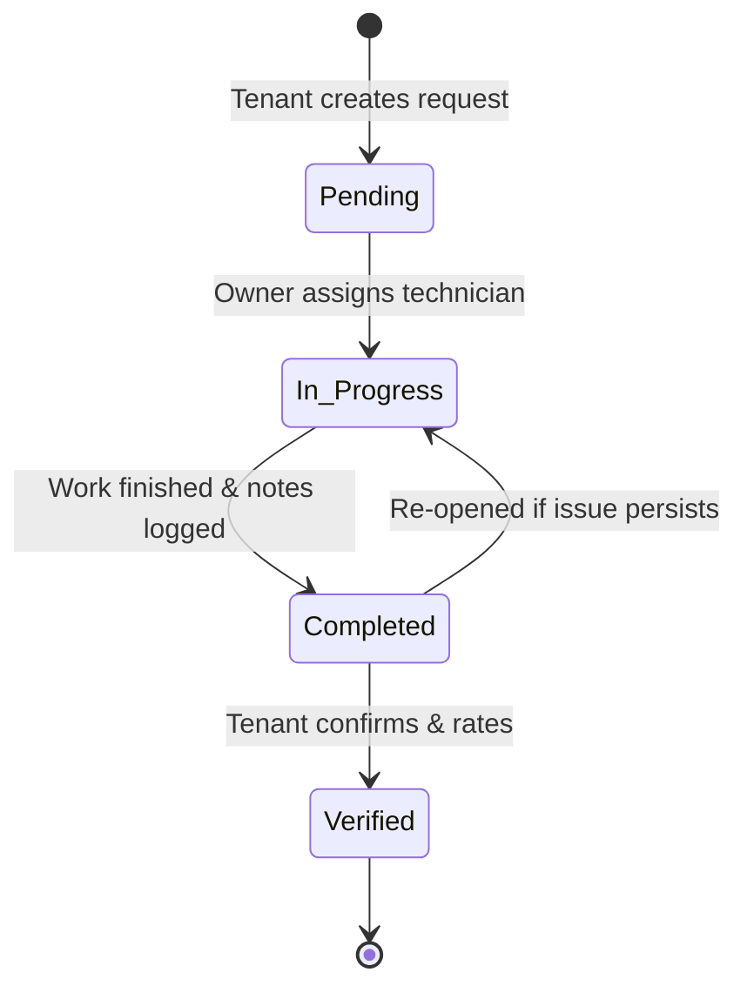
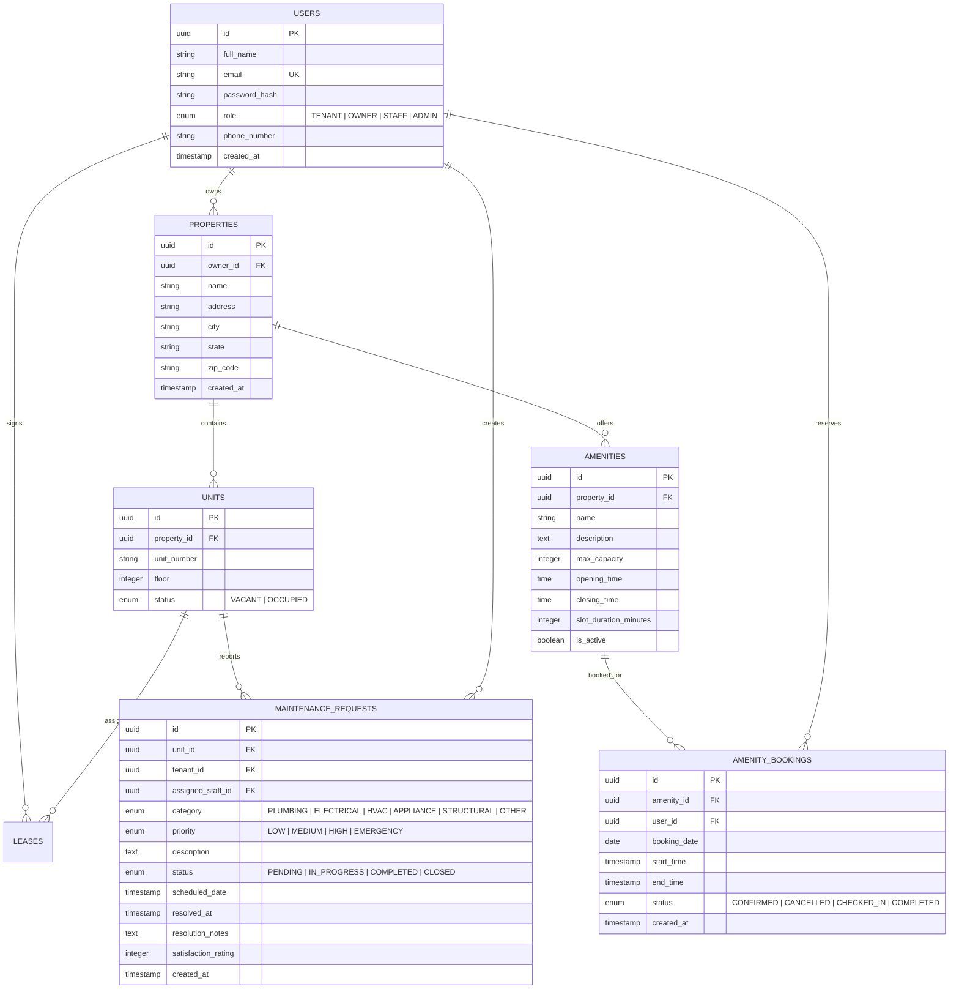
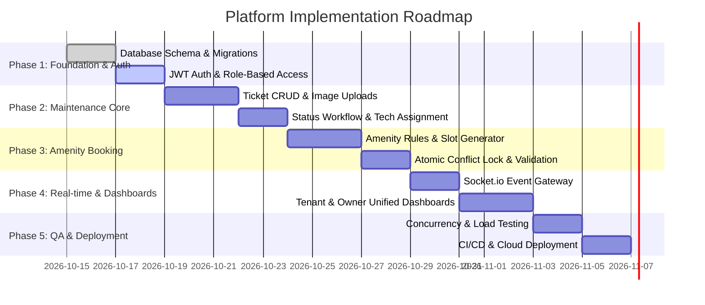

# Real-Time Property Rental, Maintenance & Amenity Management Platform
## Comprehensive Project Analysis, System Requirements & Technical Architecture Guide

---

## 1. Executive Summary & Project Context

The **Real-Time Property Rental, Maintenance & Amenity Management Platform** addresses the inefficiencies, communication bottlenecks, and booking conflicts inherent in conventional rental property operations. 

Modern residential and commercial rental ecosystems face friction due to fragmented channels (WhatsApp, phone calls, paper logs, disconnected spreadsheets). This platform delivers a centralized, real-time single source of truth for:
1. **Tenants:** Instant maintenance ticketing, live status tracking, transparent amenity discovery, and conflict-free booking.
2. **Property Owners / Managers:** Real-time visibility into property health, operational dashboards, work-order delegation, and resource utilization.
3. **Maintenance Staff / Vendors:** Live task assignment queues, status progression updates, and resolution logging.

### Benchmark References
- **Zillow Rental Manager / Buildium / AppFolio:** Industry-standard operational workflows.
- **Unified Mentor Project Standards:** Academic and professional rigor with clear deliverables, measurable KPIs, and clean modular code.

---

## 2. Stakeholder & Persona Analysis

| Persona | Role | Key Goals & Needs | Pain Points Solved |
| :--- | :--- | :--- | :--- |
| **Tenant** | Resident of leased property/unit | Quick issue reporting, transparent updates, reserve clubhouse/pool/gym without disputes | Eliminates unanswered phone calls, unexpected repair delays, and amenity double-bookings |
| **Property Owner / Manager** | Oversees property assets & leases | Comprehensive dashboard, track technician turnaround, monitor amenity health & compliance | Eliminates untracked expenses, manual log sheets, and tenant dissatisfaction |
| **Maintenance Personnel / Contractor** | Resolves physical property defects | Clear task assignments, issue description/photos, resolution sign-off | Eliminates vague descriptions, lost tickets, and dispute over completion timestamps |
| **Platform Administrator** | System governance | Role-based access control (RBAC), audit logging, amenity policy configuration | Enforces system integrity and uniform data flow |

---

## 3. High-Level System Architecture

```mermaid
flowchart TD
    subgraph Client Layer [Frontend Client - React / Next.js]
        A1[Tenant Portal]
        A2[Owner / Manager Portal]
        A3[Maintenance Dashboard]
    end

    subgraph Communication Layer
        B1[REST API - HTTPS]
        B2[WebSocket / Socket.io Engine]
    end

    subgraph Application Server [Node.js + Express.js]
        C1[Auth & RBAC Middleware]
        C2[Maintenance Request Service]
        C3[Amenity Reservation & Conflict Engine]
        C4[Notification & Audit Engine]
    end

    subgraph Persistence Layer
        D1[(PostgreSQL / MongoDB)]
        D2[(Redis Cache & Booking Locks)]
    end

    Client Layer -->|HTTP / JSON| B1
    Client Layer <-->|Bi-directional Events| B2
    B1 --> C1
    B2 --> C3
    C1 --> C2
    C1 --> C3
    C1 --> C4
    C2 & C3 & C4 --> D1
    C3 <--> D2
```

---

## 4. Functional Requirements Deep-Dive

### 4.1 Maintenance Management Subsystem

#### Ticket Lifecycle & State Machine
1. **Submitted / Pending:** Tenant creates request (Category, Urgency: Low/Medium/High/Emergency, Description, Media attachment).
2. **In Review / Assigned:** Property owner/manager reviews ticket and assigns a maintenance tech. Status transitions to `In Progress`.
3. **Work-In-Progress:** Technician updates progress logs (timestamps, remarks, estimated completion).
4. **Completed / Resolved:** Technician marks task as resolved with resolution notes.
5. **Verified / Closed:** Tenant verifies the resolution and provides a satisfaction rating (1–5 stars).



### 4.2 Amenity Management & Zero-Conflict Booking Engine

#### Core Amenity Rules
- **Predefined Operational Windows:** Each amenity (Gym, Swimming Pool, Clubhouse, Tennis Court, Rooftop Lounge) defines operational hours (e.g., 06:00 to 22:00) and max concurrent slot capacities or exclusive access windows.
- **Granular Slots:** Check-in and Check-out slots (e.g., 1-hour or 2-hour blocks).
- **Concurrency & Double-Booking Prevention Algorithm:**
  - Standard mathematical interval overlap query:
    $$\text{Overlap} \iff (\text{RequestedStart} < \text{ExistingEnd}) \land (\text{RequestedEnd} > \text{ExistingStart})$$
  - Atomic database transactions with row-level locking (`SELECT ... FOR UPDATE` in SQL or atomic `$push` with optimistic locking in MongoDB) ensure zero race conditions when multiple tenants attempt to book simultaneously.

---

## 5. Database Schema & Data Models

### 5.1 Relational Schema Design (PostgreSQL / SQL Standard)



---

## 6. Real-Time Event Architecture (WebSocket Specification)

Real-time synchronization ensures instant UI updates without manual browser reloads:

| Channel / Event | Emitter | Listener | Payload |
| :--- | :--- | :--- | :--- |
| `maintenance:created` | Tenant Client | Owner / Admin Dashboard | `{ requestId, propertyId, unitNumber, priority, category, createdAt }` |
| `maintenance:status_change` | Owner / Staff | Tenant Client & Manager Dashboard | `{ requestId, oldStatus, newStatus, updatedBy, timestamp, notes }` |
| `amenity:slot_reserved` | Reservation Service | All active property viewers | `{ amenityId, bookingDate, startTime, endTime, status: "BOOKED" }` |
| `amenity:slot_released` | Cancellation Service | All active property viewers | `{ amenityId, bookingDate, startTime, endTime, status: "AVAILABLE" }` |

---

## 7. Key Performance Indicators (KPIs) & Monitoring Plan

| Metric | Target | Measurement Method |
| :--- | :--- | :--- |
| **Maintenance Resolution Time (MTTR)** | $\le$ 48 Hours | Difference between `created_at` and `resolved_at` |
| **Request Completion Rate** | $\ge$ 90% | $(\text{Resolved Tickets} / \text{Total Tickets}) \times 100$ per month |
| **Amenity Booking Conflict Rate** | **Strictly 0** | Validated via automated concurrency stress tests |
| **System Response Time (p95)** | $\le$ 2.0 Seconds | API endpoint latency monitoring |
| **Tenant Satisfaction Score (CSAT)** | $\ge$ 4.0 / 5.0 | Average rating captured on ticket resolution |

---

## 8. Step-by-Step Implementation Roadmap



### Phase 1: Core Foundation & Secure Authentication
- Project directory setup with modular separation (`/server`, `/client`).
- Schema generation with PostgreSQL/MongoDB and data validation (Zod/Joi).
- Authentication with JWT tokens, refresh tokens, and password hashing with bcrypt.

### Phase 2: Maintenance Module
- Responsive UI for creating tickets with priority flags.
- Admin table with live filtering (Status, Urgency, Property, Assigned Tech).
- Audit trail logging status history and resolution timestamps.

### Phase 3: Amenity Booking & Concurrency Engine
- Visual calendar/slot grid displaying available vs. reserved blocks.
- Strict database-level transaction validation to eliminate overlapping bookings.
- Auto-check-in / check-out state tracking.

### Phase 4: Real-time Dashboards
- WebSocket integration (Socket.io) broadcasting instant ticket and booking events.
- Executive summary metrics cards (Active Tickets, Average Resolution Time, Amenity Utilization %).

### Phase 5: Testing, Hardening & Deployment
- Automated test suites (Jest/Supertest for API endpoints, concurrency tests for booking engine).
- Containerization with Docker and deployment onto Cloud hosting (AWS / Vercel / Render).

---

## 9. Risk Matrix & Mitigation Strategies

| Identified Risk | Severity | Mitigation Strategy |
| :--- | :--- | :--- |
| **Race Conditions in Amenity Booking** | High | Implement atomic transactions with database locking and Redis mutex locks. |
| **Untracked / Stale Maintenance Requests** | Medium | Automated SLA escalation alerts for tickets exceeding 24 hours without assignment. |
| **Unauthenticated / Cross-Tenant Data Access** | Critical | Enforce strict tenant-unit association checks at the API middleware level. |
| **Network Fluctuations / Socket Disconnections** | Low | Client-side exponential backoff reconnection with fallback polling. |
